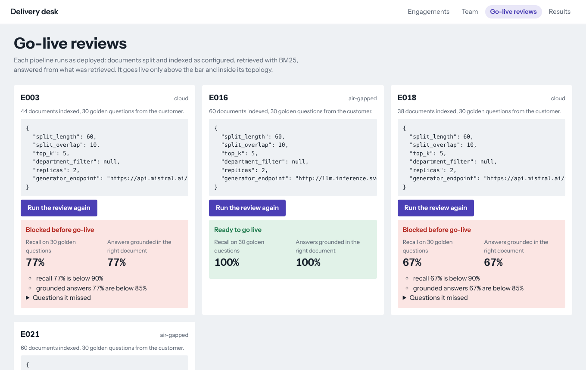
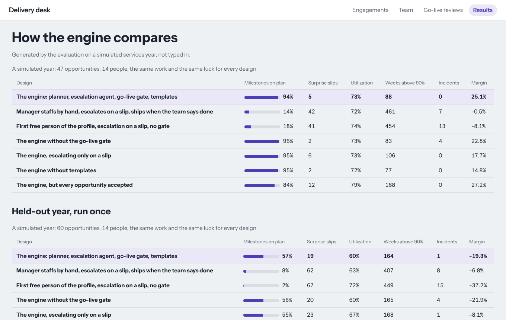

# fde-delivery-engine

The delivery engine of a forward-deployed engineering team shipping Haystack into enterprise and public-sector production: staffing by FDE profile against utilization and burnout, a go-live gate that measures customer RAG pipelines, an escalation agent, and reusable patterns from the field.

It is written from the seat of the manager who runs that team. Every Monday the manager has the same questions: who works on what this week, which engagement is about to slip and needs a call to the customer, is this pipeline good enough to go live, which piece of work have we built twice and should turn into a template, and can we take the next opportunity without burning the team. This repository answers each one in code, and measures the answers on a simulated year of engagements before trusting them.


## Dashboard

Dev year: 52 weeks, 14 forward-deployed engineers, 47 opportunities (23 public sector, 9 finance, 11 insurance, 4 manufacturing, 7 air-gapped), seed `dev-2026`. Every design below runs on the same opportunities, the same people and the same luck.

| | Engine | Note |
|---|---:|---|
| Milestones on plan | **94%** | by hand 14% |
| Surprise slips | **5** | by hand 42 |
| Person-weeks above 90% load | **88** | by hand 461 |
| Production incidents | **0** | by hand 7 |
| Margin | **25.1%** | by hand -0.5% |
| Customer escalations | **3** | by hand 28 |
| Per-engagement gain in milestones on plan | **+75.0 pts** | paired bootstrap over 37 engagements, 90% interval 67.0 to 82.5 |
| Average team load | **74%** | by hand 72%, target 82% |
| Pipelines the gate held back | **4** | would have failed in production, 0 held back that would have passed |
| Templates built from repeated work | **11** | 1664 hours saved for 328 hours spent building them |
| Held-out year, run once | **gate failed** | 56.8% on plan against 7.6% by hand, 3 of 8 lines failed, [what changed](#after-the-held-out-year) |
| Tests | **47** | 36 Python, 11 console |

### Every design on the dev year

| Design | Milestones on plan | Surprise slips | Customer escalations | Utilization | Person-weeks above 90% load | Production incidents | Margin | Declined |
|---|---:|---:|---:|---:|---:|---:|---:|---:|
| **Engine** | 94.3% | 5 | 3 | 73.2% | 88 | 0 | 25.1% | 8 |
| By hand (baseline) | 13.8% | 42 | 28 | 71.6% | 461 | 7 | -0.5% | 0 |
| First free person | 18.4% | 41 | 26 | 73.8% | 454 | 13 | -8.1% | 0 |
| Engine, no go-live gate | 96.0% | 2 | 5 | 73.4% | 83 | 4 | 22.8% | 8 |
| Engine, no escalation agent | 94.7% | 6 | 4 | 72.6% | 106 | 0 | 17.7% | 11 |
| Engine, no templates | 95.4% | 2 | 0 | 72.2% | 77 | 0 | 14.8% | 12 |
| Engine, accepts every opportunity | 84.2% | 12 | 3 | 79.3% | 168 | 0 | 27.2% | 0 |

"Person-weeks above 90% load" counts weeks in which one person was planned above 90% of their hours. It is the stretch the team pays for a milestone, not a medical measure. In the world, a person who stays there loses productivity and may fall sick.

### What the ablations say

- **The go-live gate is where incidents go.** Without it the engine ships 4 pipelines that fail in production instead of 0. Customer escalations go from 3 to 5 and margin from 25.1% to 22.8%, because every incident costs rework hours and a penalty. Milestones on plan are 96.0% without it: the gate costs the rework weeks it asks for.
- **The escalation agent is worth its money.** Without it milestones on plan are 94.7% against 94.3%, surprise slips rise from 5 to 6 and margin drops to 17.7%. Scope creep that nobody turned into a change request is unpaid work.
- **Templates are an investment.** Without them milestones on plan are 95.4% (builders spend no idle hours on templates) and margin falls to 14.8%, because every later engagement repeats the custom work.
- **Saying no is part of the job.** The engine that accepts every opportunity reaches 27.2% margin at 79.3% utilization, with 84.2% of milestones on plan, 12 surprise slips and 168 person-weeks above 90% load. The intake rule declined 8 opportunities worth €729k. That trade is the manager's call. The engine shows it before the contract is signed, and the stress year below shows what it is worth when demand outruns the team.
- **The baselines are honest.** Staffing the first free person of the right profile reaches 18.4% on plan with 13 incidents.

### The stress year

A second dev year, written after the held-out run to reproduce what it found, with its own seed: 52 weeks, 14 forward-deployed engineers, 76 opportunities (40 public sector, 9 finance, 11 insurance, 16 manufacturing, 25 air-gapped), seed `dev-stress-a`. The arrivals are more than the team can deliver, so every design is short. The engine keeps 69.5% of milestones on plan against 2.5% by hand, at 26.3% margin. Accepting everything would earn 40.2% and keep 22.9% on plan with 46 customer escalations. It is still below the 80% line. On a year like this the answer is another builder, and every intake decision says which profile was short.

| Design | Milestones on plan | Surprise slips | Customer escalations | Utilization | Person-weeks above 90% load | Production incidents | Margin | Declined |
|---|---:|---:|---:|---:|---:|---:|---:|---:|
| **Engine** | 69.5% | 23 | 7 | 78.6% | 190 | 0 | 26.3% | 38 |
| By hand (baseline) | 2.5% | 85 | 43 | 66.9% | 429 | 9 | -11.1% | 0 |
| First free person | 1.8% | 86 | 46 | 74.1% | 458 | 10 | -19.6% | 0 |
| Engine, no go-live gate | 66.1% | 27 | 15 | 82.7% | 241 | 6 | 23.5% | 38 |
| Engine, no escalation agent | 70.9% | 27 | 7 | 80.2% | 212 | 0 | 25.6% | 37 |
| Engine, no templates | 71.9% | 19 | 9 | 77.6% | 180 | 0 | 24.1% | 40 |
| Engine, accepts every opportunity | 22.9% | 126 | 46 | 86.1% | 283 | 0 | 40.2% | 0 |

### The gate, written before any result

`config/gate.json` was written before the first evaluation and is not moved. Dev:

```
pass milestones on plan                           0.9435 >= 0.8
pass milestone gain over the baseline, points     80.5 >= 10
pass surprise slips vs the baseline               0.119 <= 0.5
pass weeks above 90% load vs the baseline         0.191 <= 0.5
pass production incidents                         0 <= 1
pass utilization at least                         0.7323 >= 0.65
pass utilization at most                          0.7323 <= 0.88
pass margin share beats the baseline              0.2508 > -0.0052
GATE PASSED
```

## Held-out year

Run once on 2026-11-15, on a year nothing was tuned on: 52 weeks, 14 forward-deployed engineers, 60 opportunities (33 public sector, 12 finance, 5 insurance, 10 manufacturing, 21 air-gapped), seed `heldout-2027`. It is harder than dev: more opportunities, more public-sector and air-gapped work, more blockers, larger overruns and a thinner advisory bench. The lock records the hash of every config file it ran with. What happened and what changed afterwards is in [docs/heldout.md](docs/heldout.md).

Engine 56.8% milestones on plan against 7.6% by hand. Production incidents: 1 against 8.

| Design | Milestones on plan | Surprise slips | Customer escalations | Utilization | Person-weeks above 90% load | Production incidents | Margin | Declined |
|---|---:|---:|---:|---:|---:|---:|---:|---:|
| **Engine** | 56.8% | 19 | 14 | 60.2% | 164 | 1 | -19.2% | 35 |
| By hand (baseline) | 7.6% | 62 | 40 | 63.5% | 407 | 8 | -6.8% | 0 |
| First free person | 1.7% | 67 | 52 | 72.3% | 449 | 15 | -37.2% | 0 |
| Engine, no go-live gate | 56.2% | 20 | 18 | 60.5% | 165 | 4 | -21.9% | 35 |
| Engine, no escalation agent | 55.3% | 23 | 11 | 67.0% | 168 | 1 | -8.1% | 31 |
| Engine, no templates | 55.1% | 21 | 14 | 61.9% | 174 | 1 | -22.2% | 35 |
| Engine, accepts every opportunity | 15.2% | 78 | 48 | 84.0% | 284 | 1 | 19.3% | 0 |

```
FAIL milestones on plan                           0.5682 >= 0.8
pass milestone gain over the baseline, points     49.3 >= 10
pass surprise slips vs the baseline               0.306 <= 0.5
pass weeks above 90% load vs the baseline         0.403 <= 0.5
pass production incidents                         1 <= 1
FAIL utilization at least                         0.6016 >= 0.65
pass utilization at most                          0.6016 <= 0.88
FAIL margin share beats the baseline              -0.1925 > -0.0681
GATE FAILED
```

### After the held-out year

Three planner fixes and one intake fix came out of it (see [docs/heldout.md](docs/heldout.md)), measured on dev and on the stress year only. The held-out year was not run again. The engine before and after:

| Year | Milestones on plan | Surprise slips | Utilization | Person-weeks above 90% load | Margin | Declined |
|---|---:|---:|---:|---:|---:|---:|
| dev at the held-out run | 82.0% | 11 | 72.3% | 163 | 9.6% | 12 |
| dev now | 94.3% | 5 | 73.2% | 88 | 25.1% | 8 |
| stress at the held-out run | 57.6% | 23 | 70.8% | 197 | 6.5% | 47 |
| stress now | 69.5% | 23 | 78.6% | 190 | 26.3% | 38 |

## What is in it

**Staffing planner** (`fde/product/staffing.py`). deepset's FDE team works in four profiles: Advisory for discovery, Builder for the build, Operating for go-live, Support for hypercare. The planner places people by expected hours of progress: profile fit, a penalty for missing skills (German, clearance, air-gapped experience, connectors) and a ramp-up cost for anyone new to the engagement. It aims to finish a phase a week early with a safety margin, keeps people near the utilization target, lets a person stretch to a full week only when a milestone is at stake and not two weeks in a row, and fills idle builder hours with template work.

**Escalation agent** (`fde/product/escalation.py`). A model reads each weekly status note, German or English, and returns signals: blocker, data access, scope change, sentiment, percent done. The model only reads. Code decides: a weighted score over the signals and the forecast, with a kind (unblock, change request, relationship, capacity) that tells the manager which call to make. The note text is data and never instructions. Without an API key a bilingual keyword reader does the same job.

**Go-live gate** (`fde/product/gate.py`). Before a customer RAG pipeline ships, the gate builds it in Haystack (DocumentSplitter, InMemoryDocumentStore, InMemoryBM25Retriever and an extractive answerer) with the customer's own configuration, runs 30 golden questions, and measures retrieval recall (at least 90%) and grounded answers (at least 85%). It also lints the topology: an external generator endpoint in an air-gapped deployment is a hard stop.

**Patterns from the field** (`fde/product/patterns.py`). When the same piece of work (a SharePoint connector, PII redaction, packaging a model for an air-gapped install) has been built on 2 engagements, it becomes a template and a product request. Later engagements do that work faster.

**Intake** (`fde/product/intake.py`). Before an opportunity is accepted, its hours are spread to their due dates on top of the work already planned. If any profile would run above its share of capacity over the next weeks, the engine declines and says which profile is short.

**Service** (`fde/service/app.py`). FastAPI with API keys and roles (manager, FDE), an append-only hash-chained audit log in memory or Postgres, Prometheus counters at `/metrics`, and the console.

**Console** (`web/`). React, TypeScript and Framer Motion. Engagements riskiest first with the escalation verdict on a new note, the week's staffing board, go-live reviews that run the gate, and the results. Every screen has loading, error and empty states.






## How it is kept honest

- The truth stays in the world. `fde/world` knows how fast each person really works, what a blocker really is and which pipeline will fail in production. `fde/product` and `fde/service` never import it; a test checks.
- The world does not read the product's settings. `config/world.json` is read only by `fde/world`, `config/product.json` only by the product.
- Same luck for every design. Every random draw is keyed by what it is about (seed, week, engagement, person), not by the order of calls, so a design that does something different does not change the luck of anything else.
- The model reads and code decides.
- The gate was written before the first result, and the held-out year runs once.
- This README is generated by `python -m fde.eval.cli readme`. CI regenerates it and fails if it differs.

## Run it

```bash
python -m venv .venv && . .venv/bin/activate
pip install -r requirements.txt
pytest -q tests                      # the Python tests
python -m fde.eval.cli evaluate      # the dev year, writes reports/dev.json
python -m fde.eval.cli gate          # checks it against config/gate.json
python -m fde.eval.cli readme        # writes this file
uvicorn fde.service.app:app --port 8790
cd web && npm ci && npm run dev       # the console on :5173
```

Or `docker build -t fde-delivery-engine . && docker run -p 8790:8790 fde-delivery-engine` and open http://localhost:8790. Set `ANTHROPIC_API_KEY` to read status notes with Claude, and `DATABASE_URL` to keep the audit log in Postgres.

## Limits

- The year is simulated. The rates, the profiles and the kinds of work come from public material about forward-deployed teams and Haystack deployments; the people, customers and pipelines are invented.
- The gate measures retrieval and extractive answers with BM25. A real deployment would add the customer's generator and embedding retrieval to the same golden questions.
- The planner plans one week at a time. It does not optimise the whole quarter.
